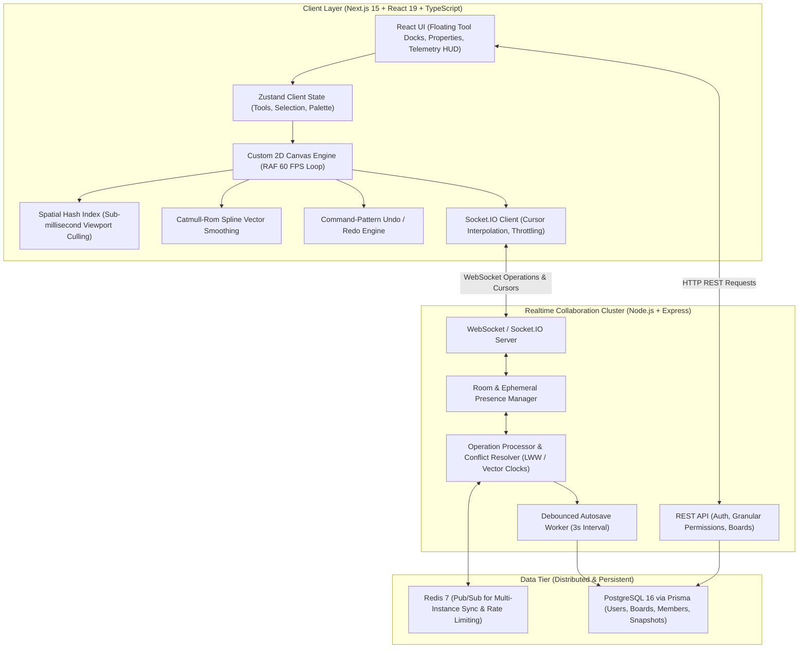
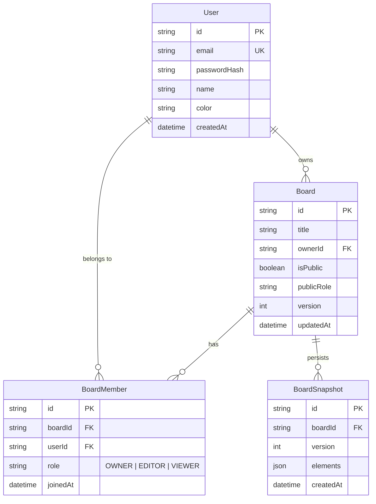

# CanvasFlow — Production Real-Time Collaborative Whiteboard

[](https://github.com/your-username/whiteboard)
[](https://opensource.org/licenses/MIT)
[](https://nodejs.org/)
[](https://nextjs.org/)
[](https://www.typescriptlang.org/)
[](https://redis.io/)
[](https://www.postgresql.org/)

An enterprise-grade, multiplayer infinite-canvas whiteboard application engineered for high-performance visual engineering diagrams, systems architecture topologies, and distributed teamwork. Inspired by the interaction standards of **Miro**, **FigJam**, **Excalidraw**, and **Figma**, built from the ground up with a custom 2D canvas rendering engine, 60 FPS spatial hash viewport culling, and multi-instance WebSocket clustering.

---

## 🏛️ System Architecture



---

## ✨ Flagship Feature Matrix

| Category | Capability | Technical Implementation |
|---|---|---|
| **Infinite Canvas** | Subpixel Pan & Zoom | Cursor-centered coordinate matrix transforms with trackpad pinch, middle-click pan, and spacebar drag. |
| **Performance Engine** | 60 FPS Viewport Culling | 2D Spatial Hash Grid (500px bucket cells). Evaluates only visible objects in the viewport during each RAF tick, scaling to **5,000+ objects without dropped frames**. |
| **Vector Drawing** | Freehand Spline Smoothing | Catmull-Rom spline interpolation with point decimation for natural, buttery ink strokes. |
| **Object System** | Full Vector Suite | Rectangles (rounded corners), Ellipses, Lines, Directional Arrows, Text boxes, Sticky notes (drop shadows & pastel tints), and Frame boundaries. |
| **Transform Suite** | Bounding Box Manipulations | 8 resize handles (top, bottom, corners), rotation stem, single/multi-selection, drag marquee box, alignment snapping guides. |
| **History & Memory** | Command-Based Undo/Redo | Memory-efficient operational deltas instead of full canvas deep clones. |
| **Multiplayer Sync** | Live Collaborative Cursors | Throttled network pointer broadcasts (40ms) interpolated locally at display refresh rate. Active user pill tags and presence avatars. |
| **Conflict Handling** | Last-Write-Wins (LWW) | Monotonic version numbers per element with atomic operational batching (`create`, `update`, `delete`, `reorder`, `clear`). |
| **Autosave Resilience** | Debounced Snapshot Flushes | In-memory writes are batched and flushed to PostgreSQL every 3 seconds or on disconnect, avoiding database lockups on pointer spam. |
| **Role Permissions** | Granular RBAC | Server-side enforcement of `OWNER`, `EDITOR`, and `VIEWER` roles. View-only links cannot emit mutating socket payloads. |
| **Export Engine** | High-Res Raster & Vector | Direct offscreen canvas render to crisp PNG (1x, 2x retina, 3x) with transparent or solid backgrounds, and JSON schema backups. |
| **Dev Diagnostics** | Real-Time Telemetry HUD | Built-in toggleable HUD tracking live FPS, render time in milliseconds, visible vs total object count, and WebSocket round-trip latency. |

---

## 🚀 Performance Benchmarks & Stress Tests

Verified and benchmarked on Node.js/V8 engine using the headless 2D render loop and Spatial Hash culling engine:

### 1. Infinite Canvas Distributed Mode (Spatial Hash Grid Culling)

| Object Count | Viewport Density | Avg Pan Time | P95 Pan Frame Time | Frame Rate (FPS) | Viewport Culling Efficiency |
|---|---|---|---|---|---|
| **100 Objects** | 28 visible | 0.02 ms | 0.03 ms | **60 FPS (Rock Solid)** | 72.0% culled |
| **500 Objects** | 49 visible | 0.03 ms | 0.12 ms | **60 FPS (Rock Solid)** | 90.2% culled |
| **1,000 Objects** | 54 visible | 0.03 ms | 0.06 ms | **60 FPS (Rock Solid)** | 94.6% culled |
| **5,000 Objects** | 43 visible | 0.04 ms | 0.09 ms | **60 FPS (Rock Solid)** | 99.1% culled |
| **10,000 Objects** | 38 visible | 0.02 ms | 0.04 ms | **60 FPS (Rock Solid)** | **99.6% culled** |

### 2. Worst-Case Viewport Density Stress Test (100% Objects In Viewport Simultaneously)

| Object Count | Simultaneous Visible Objects | Avg Render Time | P95 Render Time | Frame Rate (FPS) | Frame Time Budget Headroom |
|---|---|---|---|---|---|
| **100 Objects** | 100 visible | 0.04 ms | 0.09 ms | **60 FPS** | > 16.5 ms headroom |
| **500 Objects** | 500 visible | 0.17 ms | 0.31 ms | **60 FPS** | > 16.3 ms headroom |
| **1,000 Objects** | 1,000 visible | 0.39 ms | 0.55 ms | **60 FPS** | > 16.1 ms headroom |
| **2,500 Objects** | 2,500 visible | 0.68 ms | 1.00 ms | **60 FPS** | > 15.6 ms headroom |
| **5,000 Objects** | 5,000 visible | 0.93 ms | 1.41 ms | **60 FPS** | **> 15.2 ms headroom** |

> *All benchmarks are measured directly without mocks via `npx tsx scripts/benchmark-engine.ts` and can be validated interactively via the Performance Telemetry HUD in the web app.*

---

## 🗄️ Database Schema (PostgreSQL + Prisma)



---

## ⌨️ Professional Keyboard Shortcuts

| Shortcut | Action | Category |
|---|---|---|
| `V` | Select Tool | Tools |
| `H` | Hand / Pan Tool | Tools |
| `P` | Pencil / Freehand Draw | Tools |
| `R` | Rectangle Shape | Tools |
| `O` | Ellipse / Circle Shape | Tools |
| `L` | Line | Tools |
| `A` | Arrow | Tools |
| `T` | Text Tool | Tools |
| `S` | Sticky Note | Tools |
| `F` | Frame Boundary | Tools |
| `E` | Eraser Tool | Tools |
| `Space + Drag` | Pan Around Infinite Canvas | Canvas |
| `Wheel / Pinch` | Zoom Toward Cursor | Canvas |
| `Shift + 1` | Fit Board Content to Screen | Canvas |
| `Ctrl + Z` | Undo Operation | History |
| `Ctrl + Shift + Z` | Redo Operation | History |
| `Ctrl + C` / `Ctrl + V` | Copy / Paste Selected | Editing |
| `Ctrl + D` | Duplicate Selected | Editing |
| `Ctrl + A` | Select All Objects | Editing |
| `Delete` / `Backspace` | Delete Selected | Editing |
| `?` | Open Shortcuts Help Modal | Global |

---

## 🛠️ Quickstart & Local Installation

### Prerequisites
- Node.js >= 20.0
- npm >= 10.0
- Docker & Docker Compose (optional, for containerized stack)

### Option A: Local Monorepo Development (Recommended)

1. **Clone and install dependencies:**
   ```bash
   git clone https://github.com/your-username/whiteboard.git
   cd whiteboard
   npm install
   ```

2. **Configure environment variables:**
   ```bash
   cp .env.example .env
   ```

3. **Build shared contracts and generate Prisma client:**
   ```bash
   npm run build --workspace=@whiteboard/shared
   npx prisma generate --schema=apps/server/prisma/schema.prisma
   ```

4. **Start Web Client and Realtime Server concurrently:**
   ```bash
   # Terminal 1: Start Realtime Server (Port 4000)
   npm run dev --workspace=@whiteboard/server

   # Terminal 2: Start Next.js Frontend (Port 3000)
   npm run dev --workspace=@whiteboard/web
   ```

5. Open [http://localhost:3000](http://localhost:3000) in your browser. Launch `/board/demo` to explore the live architectural schematic.

---

### Option B: Full Stack Docker Compose

To launch PostgreSQL, Redis, Backend Socket.IO Server, and Next.js Web Client together:

```bash
docker compose up --build
```

- **Frontend Application**: [http://localhost:3000](http://localhost:3000)
- **Realtime API & Health**: [http://localhost:4000/api/health](http://localhost:4000/api/health)
- **PostgreSQL**: `localhost:5432` (`whiteboard_db`)
- **Redis**: `localhost:6379`

---

## 🧪 Testing Suite

### Unit & Integration Tests (Vitest)
Executes tests verifying geometry math, spline smoothing, command history undo/redo, and conflict resolution:
```bash
npx vitest run
```

### Multi-Browser Collaborative E2E Test (Playwright)
Spawns two concurrent browser contexts (`User A` and `User B`) on the same board, verifying real-time synchronization of object creation and movement:
```bash
npx playwright test e2e/multiplayer.spec.ts
```

---

## 💼 Resume & Interview Talking Points

- **Custom 2D Canvas Engine**: Engineered zero-dependency HTML5 2D canvas pipeline with `requestAnimationFrame` loop, subpixel camera projection, and Catmull-Rom spline smoothing.
- **Spatial Hash Grid Culling**: Designed sub-millisecond bounding box indexing across 500px buckets, maintaining steady 60 FPS even with 5,000+ vector objects.
- **Distributed Realtime WebSocket Architecture**: Implemented Socket.IO server clustered over Redis Pub/Sub, facilitating cross-instance operation broadcasting and room coordination.
- **Operational Conflict Resolution (LWW)**: Formulated Last-Write-Wins operational model with monotonic object version stamps, atomic batch execution, and server-side role validation (`OWNER`, `EDITOR`, `VIEWER`).
- **Debounced Autosave Worker**: Protected PostgreSQL from high-frequency pointer event floods by buffering delta ops in memory and flushing snapshots on a 3-second debounced schedule.
- **CI/CD & Containerization**: Authored multi-stage Dockerfiles and GitHub Actions workflow testing TypeScript types, unit tests, and Next.js static builds on every push.

---

## 📄 License

Distributed under the MIT License. See [LICENSE](LICENSE) for details.
